# TallyKhata Clone

A complete digital business ledger (টালি), daily cashbox (ক্যাশবক্স), and TallyPay (টালিপে) super-app built with Flutter, Material 3, edge-to-edge full-screen UI, `SharedPreferences` local persistence, native A4 Bangla PDF reporting, and *Noto Sans Bengali* typography.

---

## Features

- **Two-Stage Splash & Onboarding Experience (`lib/screens/splash/`, `lib/screens/auth/`)**:
  - **2-Stage Splash Screen**: Displays the rounded TallyKhata icon box (`tallykhata_logo.png`) for 1.2s, smoothly transitions via `AnimatedSwitcher` to the full branded splash (`tallykhata_logo1.png`, Bangladesh Bank license badge `tallykhata_logo2.jpg`, and green security shield `tallykhata_logo3.jpg`), and navigates automatically based on saved registration state.
  - **Auto-Advancing 3-Slide Onboarding Carousel**: Highlights Bangla QR payments, wallet/bank transfers, and 100% secure transactions with 11-digit mobile number validation.
  - **Registration, Gold Confetti Welcome & QR Intro**: Dynamic business name registration, 30-day TallyKhata Gold trial welcome screen with custom confetti animation, and 2-step TallyPay QR introduction.
- **Per-Business Accounting Engine & Persistent Storage (`lib/core/state/app_state.dart`, `lib/core/models/models.dart`)**:
  - Centralized `AppState` (`ChangeNotifier`) exposed via `AppScope` (`InheritedNotifier`) and persisted automatically to `SharedPreferences`.
  - **Multi-Business Support (up to 5 Businesses)**: Each business maintains its own customers, suppliers, ledger transactions, cashbox entries, stock products, and notes. Pure-white bottom sheets (`BusinessSwitcherSheet`, `BusinessPickerSheet`) with floating close buttons, primary business selector, 18-category business type picker, editing, and deletion.
- **4-Tab Main Shell & Right-Side Menu Drawer (`lib/screens/main/`)**:
  - **Tab 1 — টালি (Home / Tally)**: Gold gradient header (`GoldPage`) with dynamic-width business pill, live unread red circular Inbox badge, animated 5-step Bangla QR promotional banner, 8-item quick action grid, and a collapsible `NestedScrollView` white customer sheet where `মোট পাবো / মোট দেবো` smoothly fades out on slide-up. Includes live search, filter/sort dialog, direct PDF download, and customer/supplier ledger (`NewPartyScreen`, `PartyDetailScreen`).
  - **Tab 2 — ক্যাশবক্স (Cashbox)**: Layered cream/gold/white cards summarizing *আজকের বেচা*, *বর্তমান ক্যাশ*, *আজ পেলাম*, *আজ দিলাম*, *বাকি আদায়*, and *পেমেন্ট দেয়া*, quick *রিপোর্ট* & *ক্যাশবক্স মিলাই* pills, **Eye Privacy Toggle** (`- - -`), and 5 interactive transaction categories (*ক্যাশ বেচা*, *ক্যাশ কেনা*, *খরচ*, *মালিক দিল*, *মালিক নিল*).
  - **Tab 3 — টালিপে (TallyPay)**: Dimmed 8-action wallet grid and a collapsible white QR onboarding card (`tallykhata_logo10.jpg`) that slides smoothly over the grid.
  - **Tab 4 — মেনু (Right-Side Drawer)**: Profile header (`ProfileScreen`), Gold trial banner, links to all 5 financial reports, *সেটিংস*, *টালিখাতা গোল্ড রেফার করুন*, and footer with `tallykhata_logo8.png` and app version.
- **Business Tools, Financial Reports & Native A4 PDF Export (`lib/screens/reports/`, `lib/core/utils/cashbox_pdf.dart`)**:
  - **Stock, Notes, Tagada, Backup & SMS**: Inventory management with a draggable 16-unit selector (`StockScreen`, `NewProductScreen`), checklist business notes (`NotesScreen`), group payment reminders (`ReminderScreen`), cloud backup status (`BackupScreen`), and SMS pack store (`TaliMessageScreen`).
  - **Live Financial Reports & PDF Export**: Day/month filterable `ReportScreen` (*বেচা কেনা হিসাব*, *খরচ*, *বাকি হিসাব*, *মালিকের রিপোর্ট*) and 2-tab `CashReportScreen` (*ক্যাশবক্স রিপোর্ট* & *ক্যাশ রিপোর্ট*) with one-tap A4 PDF export featuring crisp native Bangla conjunct shaping and English formatting.
  - **Inbox, Support & Settings**: 19 campaign notifications with custom thumbnails, dashed dividers, and per-message read tracking that decrements the header badge count (`InboxScreen`); FAQ support chat (`SupportScreen`); and app settings (`SettingsScreen`) with decimal toggle, notification sound, delayed voice notification toggle, phone change, and PIN setup.

---

## Screenshots (`output/`)

All **51 screens** (including Splash stages, Onboarding slides, Customer/Supplier creation & confirmation, Party Ledger & transaction entry, Multi-Business switcher/picker, Stock & 16-unit selector, Business Notes, Cashbox & privacy mode, Financial Reports, Generated A4 Cashbox PDF Report, Inbox, Support, Profile & Settings) are captured across **Android** (`output/android/`), **iPhone** (`output/iphone/`), and **macOS Desktop** (`output/macos/`):

### Splash, Onboarding & Authentication
| Splash Stage 1 (Icon) | Splash Stage 2 (Full) | Login & Onboarding | Business Name | TallyPay QR Intro |
| :---: | :---: | :---: | :---: | :---: |
|  | 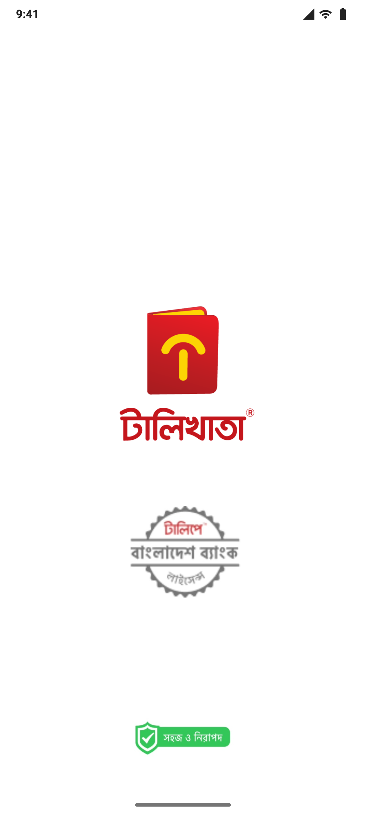 | 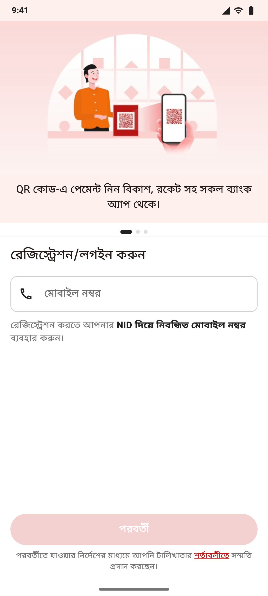 | 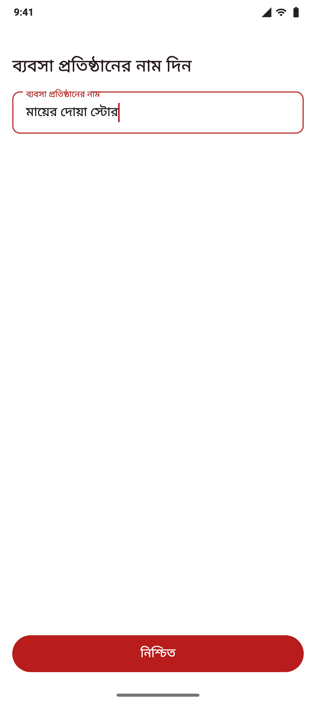 | 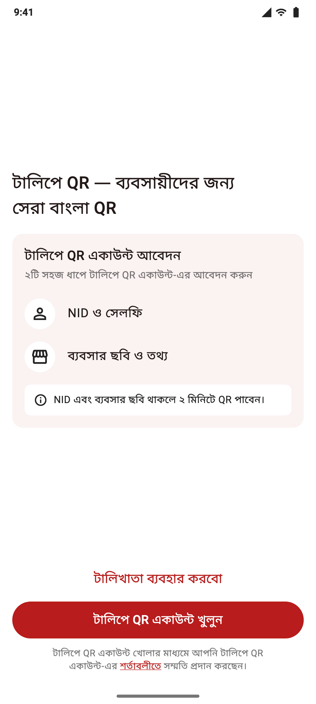 |

### Main Tabs & Navigation Drawer
| টালি (Tally Tab) | ক্যাশবক্স (Cashbox Tab) | টালিপে (TallyPay Tab) | মেনু (Navigation Drawer) |
| :---: | :---: | :---: | :---: |
| 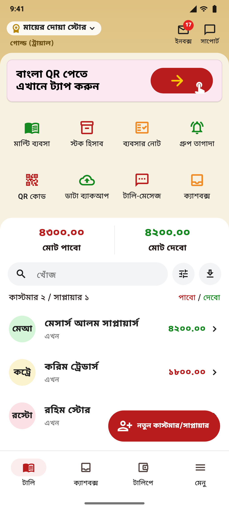 | 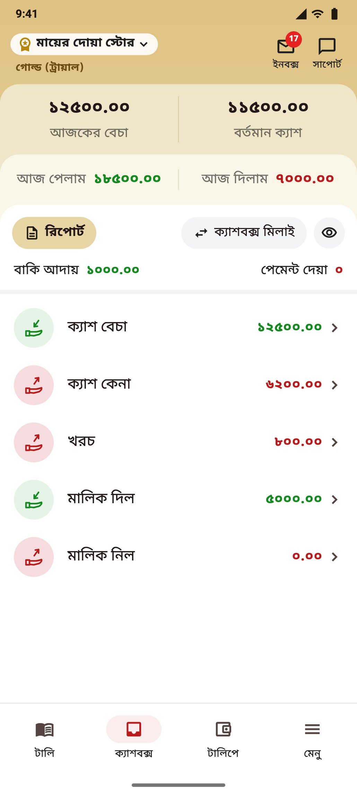 | 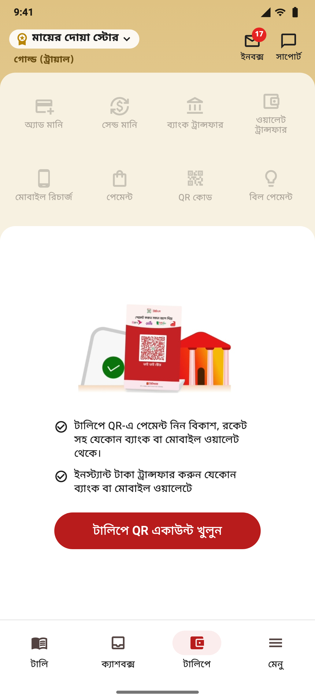 | 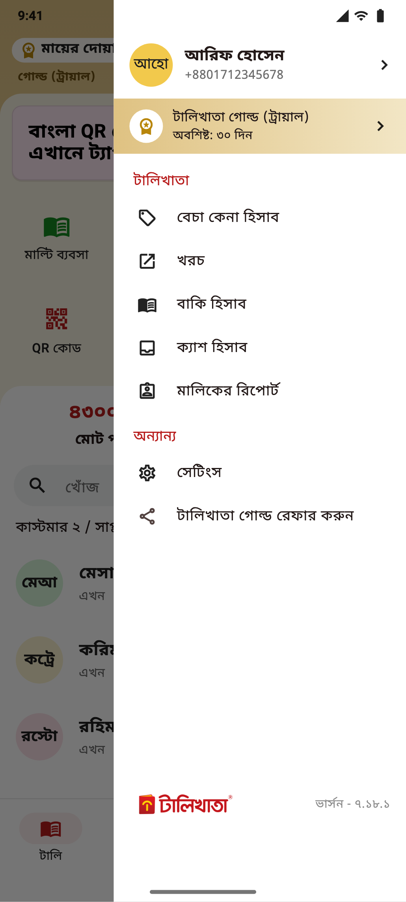 |

### Ledger, Business Switcher, Reports & Generated PDF
| পার্টি লেনদেন (Ledger) | নতুন সাপ্লায়ার (Opening Due) | ক্যাশ হিসাব (Report) | জেনারেটেড A4 PDF রিপোর্ট |
| :---: | :---: | :---: | :---: |
| 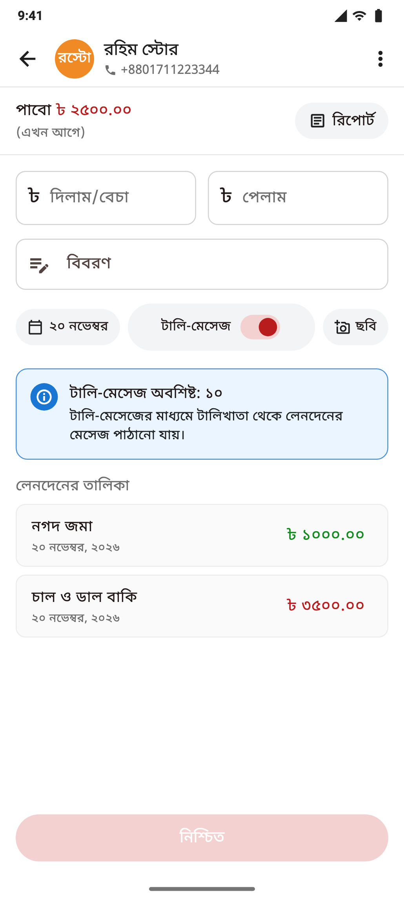 | 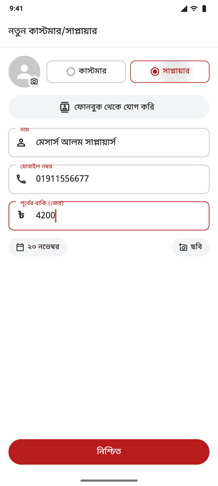 | 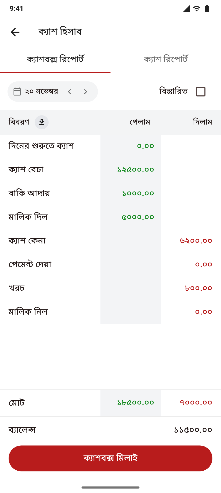 | 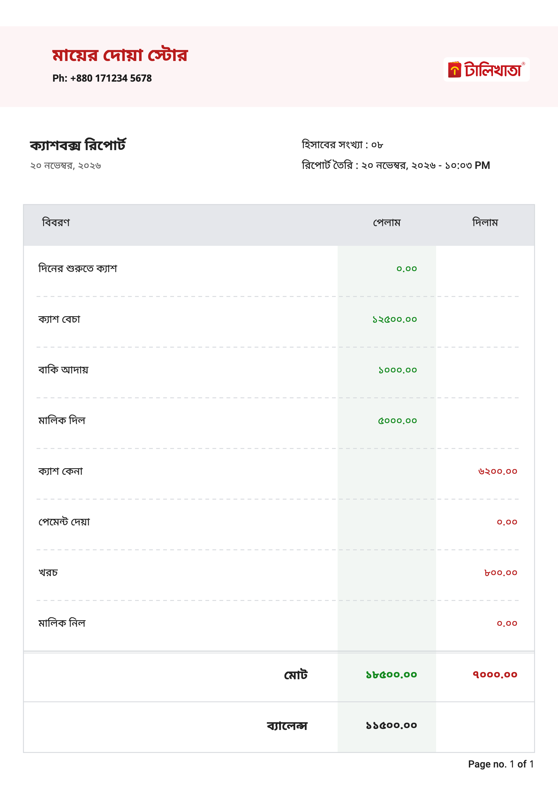 |

### Profile, Stock, Inbox & Support
| আপনার তথ্য সমূহ | স্টক হিসাব | ইনবক্স (Inbox) | সাপোর্ট (Support) |
| :---: | :---: | :---: | :---: |
| 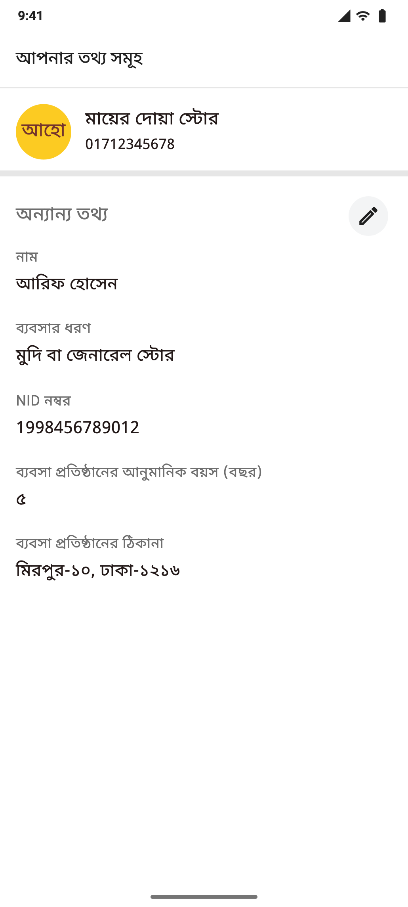 | 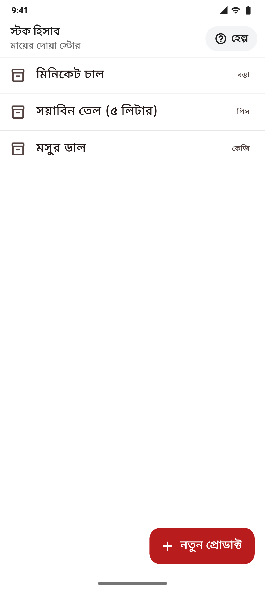 | 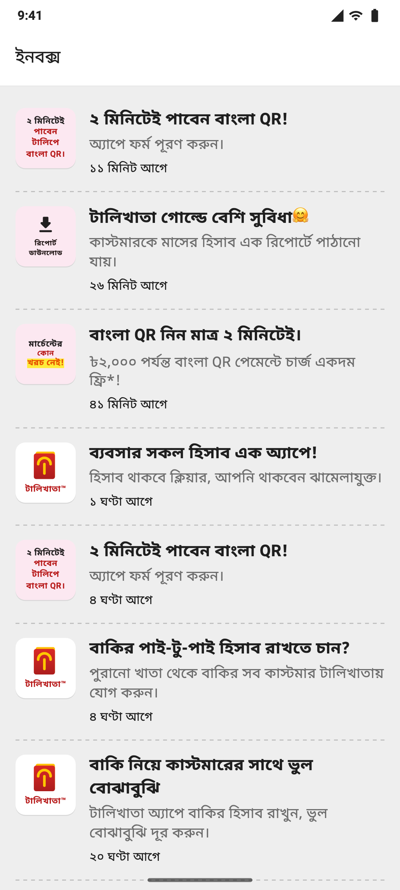 | 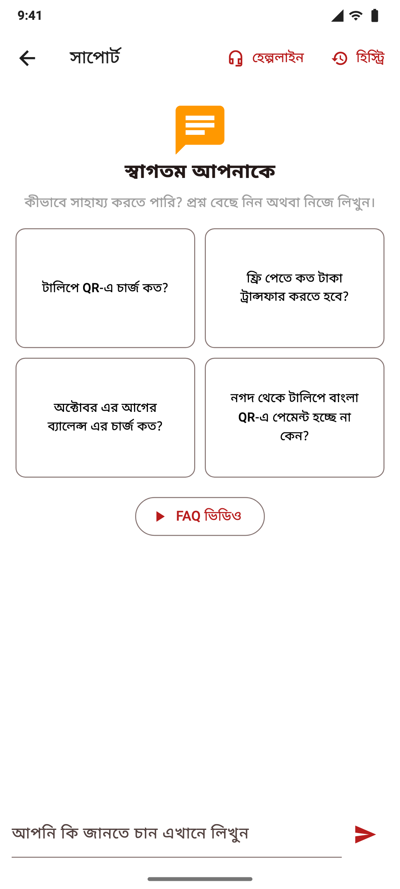 |

### macOS Desktop Widescreen Preview (`1280×820`)
| Tally Dashboard (macOS) | Cashbox Tab (macOS) |
| :---: | :---: |
| 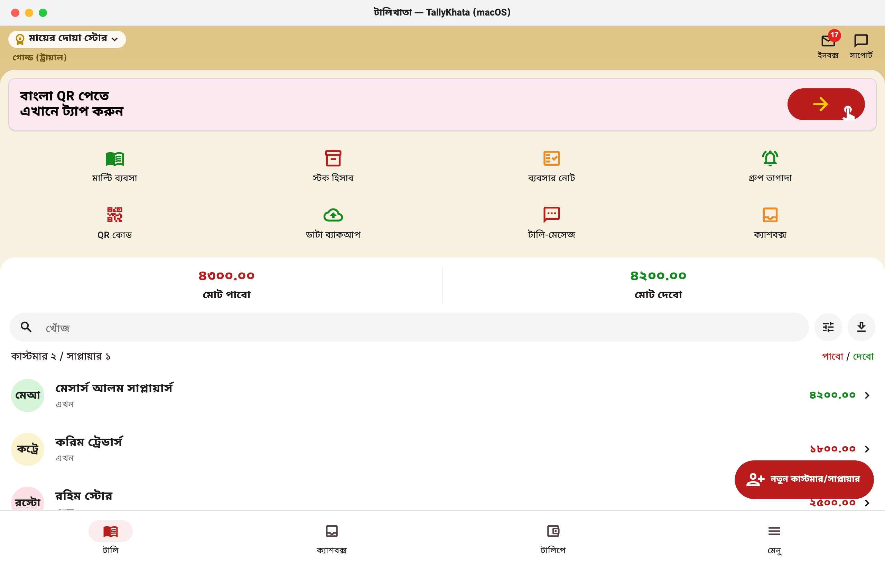 | 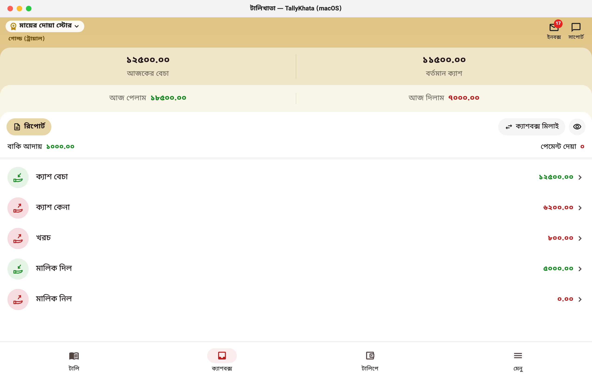 |

---

## Project Structure

```text
lib/
├── main.dart                                # Edge-to-edge init & MaterialApp entry point
├── core/
│   ├── constants/
│   │   ├── app_colors.dart                  # Brand color palette (Red, Gold, Cream, Green)
│   │   └── business_types.dart              # 18 business categories + personal ledger type
│   ├── models/
│   │   └── models.dart                      # Business, Party, PartyTxn, CashEntry, Product, Note, InboxMessage
│   ├── routes/
│   │   └── app_routes.dart                  # Centralized named routes & route generator
│   ├── state/
│   │   └── app_state.dart                   # AppState (ChangeNotifier) & SharedPreferences persistence
│   ├── theme/
│   │   └── app_theme.dart                   # Material 3 theme with Noto Sans Bengali typography
│   ├── utils/
│   │   ├── bn.dart                          # Bangla digit, currency, date & relative-time helpers
│   │   └── cashbox_pdf.dart                 # High-res native Bangla + English A4 Cashbox Report PDF
│   └── widgets/
│       ├── app_text_field.dart              # Styled outlined input with floating red label
│       ├── empty_state.dart                 # Reusable empty state placeholder
│       ├── gold_page.dart                   # Gold gradient header with business pill & unread badge
│       ├── primary_button.dart              # Rounded pill primary CTA button
│       ├── tk_app_bar.dart                  # Standardized AppBar helper
│       └── tk_logo.dart                     # Brand icon widget
└── screens/
    ├── splash/                              # Two-stage animated SplashScreen
    ├── auth/                                # Login, BusinessName, Welcome & TallyPayIntro
    ├── main/                                # MainShell (4-tab navigation) & MenuDrawer
    ├── home/                                # HomeScreen (Tally tab, QR banner & collapsible sheet)
    ├── cashbox/                             # CashboxScreen (Daily sales, cash & entry sheet)
    ├── tallypay/                            # TallyPayScreen (Wallet grid & collapsible QR sheet)
    ├── party/                               # NewPartyScreen & PartyDetailScreen (Ledger)
    ├── business/                            # Switcher, Picker, Settings, Form & Type Picker
    ├── stock/                               # StockScreen & NewProductScreen (16-unit sheet)
    ├── notes/                               # NotesScreen & NoteEditorScreen
    ├── reminder/                            # ReminderScreen (Group Tagada)
    ├── backup/                              # BackupScreen (Cloud backup status)
    ├── message/                             # TaliMessageScreen (SMS pack store)
    ├── reports/                             # ReportScreen (Buy-Sell/Expense/Due/Owner) & CashReportScreen
    ├── inbox/                               # InboxScreen & InboxDetailScreen
    ├── support/                             # SupportScreen (FAQ & chat input)
    ├── profile/                             # ProfileScreen (View & edit user info)
    └── settings/                            # SettingsScreen (Decimal, sound, voice, phone & PIN)
```

---

## Getting Started

### Prerequisites

Ensure you have the [Flutter SDK](https://docs.flutter.dev/get-started/install) installed on your machine.

### Installation & Run

1. **Navigate to the project directory:**
   ```bash
   cd tallykhata_clone
   ```

2. **Install dependencies:**
   ```bash
   flutter pub get
   ```

3. **Run the application:**
   ```bash
   flutter run
   ```

4. **Build release APK (per-ABI lightweight build):**
   ```bash
   flutter build apk --split-per-abi
   ```

5. **Run static analysis and tests:**
   ```bash
   flutter analyze
   flutter test
   ```
